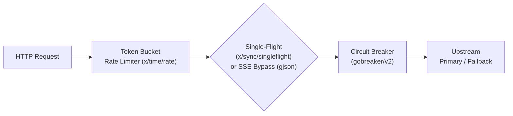

# aigate

외부 LLM 및 서드파티 HTTP API 호출 시 장애 격리, 재시도, 요청 병합, 스트리밍 프록시를 처리하는 Go HTTP 전송 계층 게이트웨이입니다. Go 표준 `net/http` 클라이언트의 `http.RoundTripper`로 직접 주입하거나 독립 리버스 프록시 데몬(`cmd/aigate`)으로 실행할 수 있습니다.

## 빠른 시작

기존 `http.Client`의 `Transport`에 `gate.NewGateway(cfg)`를 연결하면 테넌트별 레이트 리밋, 서킷 브레이커, 페일오버가 바로 적용됩니다.

```go
package main

import (
	"context"
	"log"
	"net/http"
	"strings"
	"time"

	"github.com/seungwoo7050/aigate/pkg/gate"
)

func main() {
	cfg := gate.DefaultConfig()
	cfg.RateLimit.RequestsPerSecond = 20.0
	cfg.RateLimit.Burst = 40.0
	cfg.Breaker.FailureThreshold = 3
	cfg.Breaker.Cooldown = 5 * time.Second

	cfg.Providers = []gate.ProviderConfig{
		{
			Name:     "primary-openai",
			BaseURL:  "https://api.openai.com",
			APIKey:   "sk-primary-key",
			Priority: 1,
			Timeout:  30 * time.Second,
		},
		{
			Name:     "fallback-azure",
			BaseURL:  "https://my-resource.openai.azure.com",
			APIKey:   "azure-key",
			Priority: 2,
			Timeout:  30 * time.Second,
		},
	}

	client := &http.Client{
		Transport: gate.NewGateway(cfg),
		Timeout:   60 * time.Second,
	}

	req, _ := http.NewRequestWithContext(
		context.Background(),
		http.MethodPost,
		"https://api.openai.com/v1/chat/completions",
		strings.NewReader(`{"model":"gpt-4o","messages":[{"role":"user","content":"ping"}]}`),
	)
	req.Header.Set("Content-Type", "application/json")
	req.Header.Set("X-Tenant-ID", "tenant-alpha")

	resp, err := client.Do(req)
	if err != nil {
		log.Fatalf("Request failed: %v", err)
	}
	defer resp.Body.Close()

	log.Printf("Provider: %s (Failovers: %s)",
		resp.Header.Get("X-AIGate-Provider"),
		resp.Header.Get("X-AIGate-Failover-Count"),
	)
}
```

## 동작 방식



외부 API 연동 시 특정 테넌트의 트래픽 급증으로 상위 할당량(429)이 고갈되거나 업스트림 장애 시 워커가 타임아웃까지 대기하는 문제를 막기 위해 외부 API 장애 격리 및 재시도 로직을 전송 계층에 모았습니다.

### 1. 컨텍스트 격리 Single-Flight (`pkg/gate/singleflight.go`)
표준 `golang.org/x/sync/singleflight`만 사용하면 첫 번째 호출자가 요청을 취소할 때 대기 중인 후속 호출자까지 함께 중단됩니다. `aigate`는 `context.WithoutCancel`과 대기자 참조 카운팅을 결합해, 후속 대기자가 남아 있는 동안에는 업스트림 호출을 유지하고 모든 대기자가 취소된 시점에만 업스트림 컨텍스트를 닫습니다.

### 2. Half-Open 단일 프로브와 페일오버 (`pkg/gate/breaker.go`, `failover.go`)
`gobreaker/v2`의 `TwoStepCircuitBreaker`를 사용해 `Open`에서 `Cooldown` 경과 후 `Half-Open`으로 넘어갈 때 동시 요청이 몰려도 단 1개의 프로브 요청(`MaxHalfOpenProbes`)만 업스트림으로 보냅니다. 나머지 요청과 `5xx`, `429`, 타임아웃 응답은 `slices.SortFunc`로 정렬된 Fallback 프로바이더로 즉시 우회합니다. 재전송을 위해 요청 본문은 `MaxBodyBytes`(기본 10MB) 한도 내에서 복제합니다.

### 3. 테넌트별 레이트 리밋과 무버퍼 SSE (`pkg/gate/ratelimit.go`, `sse.go`)
`golang.org/x/time/rate`의 `Limiter`와 `ReserveN`으로 테넌트별 토큰을 소비하고 초과 시 `Retry-After` 헤더를 계산하며, 유휴 버킷은 주기적으로 정리합니다. 스트리밍 요청은 `tidwall/gjson`의 `gjson.GetBytes`로 전체 언마샬링 없이 `"stream": true` 여부만 판별한 뒤 `http.Flusher`로 청크마다 즉시 내보냅니다.

### 4. 패키지 구성

```text
pkg/gate/
├── config.go         설정 모델과 에러 정의 (ProviderConfig, RateLimitConfig, BreakerConfig)
├── ratelimit.go      x/time/rate 기반 테넌트별 레이트 리미터와 유휴 버킷 정리
├── singleflight.go   호출자 컨텍스트 격리 요청 병합기
├── breaker.go        gobreaker/v2 기반 3상태 서킷 브레이커
├── failover.go       우선순위 기반 다중 프로바이더 라우터
├── sse.go            gjson 스트리밍 판별 및 무버퍼 청크 Flush 프록시
├── transport.go      promhttp 메트릭 수집기 및 http.RoundTripper/Handler 결합체
└── transport_test.go 동시성 및 장애 격리 불변조건 테스트
cmd/aigate/
└── main.go           signal.NotifyContext 기반 독립 리버스 프록시 데몬
```

## 독립 프록시 데몬 실행

```sh
make build

./bin/aigate -listen :8081 \
  -primary http://localhost:9001 \
  -primary-key "sk-primary-..." \
  -fallback http://localhost:9002 \
  -fallback-key "sk-fallback-..." \
  -rps 20 \
  -burst 40 \
  -failure-threshold 3 \
  -cooldown 5s
```

데몬 실행 후 아래 엔드포인트로 상태와 지표를 확인할 수 있습니다.

- 상태 확인: `GET http://localhost:8081/healthz`
- Prometheus 메트릭: `GET http://localhost:8081/metrics`
  - `aigate_requests_total`: 처리한 전체 요청 수
  - `aigate_coalesced_total`: Single-Flight로 병합된 요청 수
  - `aigate_rate_limited_total`: 레이트 리밋(429)으로 차단된 요청 수
  - `aigate_failover_total`: 대체 프로바이더로 우회한 횟수
  - `aigate_circuit_state{provider="..."}`: 서킷 상태 (`0`=Closed, `1`=HalfOpen, `2`=Open)

## 검증

외부 API 키나 네트워크 연결 없이 로컬 테스트 서버(`httptest`)로 모든 단위 테스트와 레이스 검사를 실행할 수 있습니다.

```sh
go vet ./...
go test -race ./...
```

주요 검증 항목은 리더 컨텍스트 취소 시 후속 대기자 수신(`TestSingleFlightLeaderCancelDoesNotAbortFollowers`), 전원 취소 시 업스트림 중단(`TestSingleFlightAllCallersCancelAbortsUpstream`), Half-Open 단일 프로브(`TestCircuitBreakerHalfOpenSingleProbe`), 503/서킷 Open 시 페일오버(`TestFailoverOnPrimary503AndCircuitOpen`), SSE 무버퍼 Flush(`TestSSEStreamFlushesChunksImmediately`), 429 및 `Retry-After` 계산(`TestTokenBucketRateLimitAndRetryAfter`), 20개 동시 요청 경합(`TestConcurrentSingleFlightContention`)입니다.

단일 프로세스의 인메모리 뮤텍스로 버킷과 서킷 상태를 관리하므로 다중 인스턴스 환경에서 전역 할당량을 공유하려면 외부 저장소가 필요하며, 페일오버 재시도를 위한 본문 복제는 `MaxBodyBytes`(기본 10MB) 이내 요청으로 제한됩니다.
